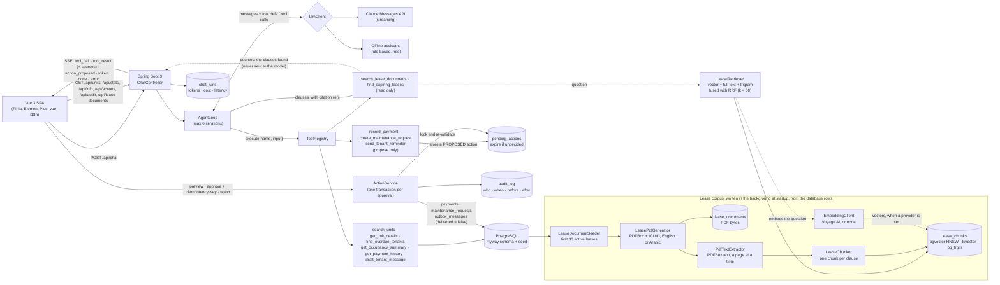

# PropPilot

[](https://github.com/NguyenMinhDuc98/proppilot/actions/workflows/ci.yml)

**A bilingual (English / Arabic) AI assistant for property managers: ask a question in either language and an agent answers by calling typed tools against a property database, streaming its work live.**

> **Live demo:** https://proppilot-lake.vercel.app runs **real Claude (Haiku 4.5)**. A badge at the top of the app always shows the active mode: `Claude Haiku 4.5` or `Offline demo`. Run locally with no key and it uses the free offline assistant instead. The free-tier API sleeps when idle, so the first request after a pause can take a few minutes while it wakes up.

All data is fake seed data (3 cities, 6 buildings, 150 units, 120 tenants, 12 months of payments), and the 30 lease documents are generated from it. No real companies or people.

## Screenshots

Captured from the live demo, answered by real Claude.


The "How I answered" panel shows each step, the tool arguments, tokens, cost, latency and model:


Arabic is a full right-to-left mirror, not just translated text, and the layout adapts to phones:


## What it shows

- **A hand-written agent loop** (no Spring AI / LangChain4j): send messages and tool definitions, run the tools the model asks for, feed results back, repeat, with a hard iteration cap.
- **Tool registry:** every tool is a Spring bean implementing `Tool`; the registry collects them and generates the tool list for the API. Tools are typed (no raw SQL from the model) and return clean errors the model can act on. Eight only read; three only propose a change.
- **Human-in-the-loop write actions:** the agent can propose recording a payment, opening a maintenance request or queueing a tenant reminder, but nothing is written until a person approves it in the app. Approval is idempotent, runs in one transaction and is audited ([details](#human-in-the-loop-write-actions)).
- **Lease search with citations (RAG):** lease questions are answered from lease PDFs in English and Arabic. Hybrid retrieval (vectors, full text and trigrams, fused with reciprocal rank fusion) finds the clauses, the answer cites each one as `[LSE-A-203#5]`, and the app turns the marker into a chip that opens the clause and its PDF. It works with no embedding key, on keywords alone ([details](#lease-search-rag)).
- **Streaming UX over SSE:** the UI shows live "Searching units…" chips, then streams the answer.
- **Cost and latency tracking** per question (`chat_runs` table, shown under each answer and on a Usage page).
- **A transparent agent:** every answer has an expandable "How I answered" panel showing the tool call and its arguments, what the tool returned, tokens, cost and latency.
- **Real Arabic support:** vue-i18n, `dir="rtl"` flipping, Element Plus Arabic locale, bidi-safe numbers.
- **Resilient LLM calls:** retries with exponential backoff and jitter on 429/5xx/529 (never after text has streamed), a per-question run deadline, replies cut off by `max_tokens` detected and flagged, and coded errors with localized messages (raw provider text never reaches the browser).
- **Honest accounting:** a run that the browser abandons is still recorded with the tokens and cost spent so far (`ABORTED`).
- **Privacy by default:** the public Usage page shows aggregates only; visitors' question text is readable only through an admin endpoint behind a token. Decisions are attributed to an anonymous name, never an address.
- **Zero-cost by default:** the app runs with a built-in offline assistant, so it works with no API key. Set one env var to switch to real Claude.

## Architecture



## How the agent loop works

`AgentLoop` ([source](backend/src/main/java/dev/proppilot/agent/AgentLoop.java)) is the whole idea. Each step is one model call and the tools it asked for (simplified from `step()`):

```java
var interruption = interruption();               // the client left, or the run is out of time
if (interruption.isPresent()) return interruption;

var response = llm.complete(new LlmRequest(system, List.copyOf(messages), toolSpecs, timeLeft()),
        text -> events.accept(new AgentEvent.Token(text)));       // stream text as it arrives
usage = usage.plus(response.usage());

if (response.stopReason() == StopReason.MAX_TOKENS) {             // tool calls may be cut off: run none
    return Optional.of(result(Status.TRUNCATED, response.text()));
}
messages.add(new Message(Message.Role.ASSISTANT, response.content()));

var requested = response.toolUses();
if (requested.isEmpty()) {                                        // final answer
    return Optional.of(result(Status.OK, response.text()));
}
return runTools(requested);                                       // results go back on the next step
```

The loop repeats steps until a final answer, the iteration cap (default 6) or the run deadline (default 90 s).

- `ToolRegistry.execute` never throws: bad input, unknown tools and unexpected failures come back as error results (`is_error: true`), so the model can correct itself instead of the request failing.
- The system prompt tells the model to reply in the user's language, only state numbers returned by tools, and not to mention internal tool names; the UI shows the data sources itself as localized labels.
- `LlmClient` has two implementations: `AnthropicLlmClient` (plain HTTP, a retry policy, a stream watchdog, and a hand-written SSE parser for text and tool-use blocks) and `OfflineLlmClient`.
- The agent loop is tested against a scripted fake LLM: tool round trips, error feedback, the iteration cap, truncation, cancellation, the deadline, LLM failures and history handling.

### SSE events

`POST /api/chat` with `{"message": "...", "history": [{"role":"user|assistant","text":"..."}]}`:

| Event | Payload |
|---|---|
| `tool_call` | `{name, args}` |
| `tool_result` | `{name, summary, error}`; the result of a lease search also carries `sources`, the clauses it found (see [Lease search](#sources-on-the-tool_result-event)) |
| `action_proposed` | the proposed action, sent right after the `tool_result` of the tool that proposed it: `{id, kind, status, args, preview, summaryEn, summaryAr, createdAt, expiresAt, ...}` |
| `token` | `{text}` |
| `error` | `{message, code}`, where `code` is `llm_overloaded`, `llm_timeout`, `llm_auth`, `llm_error` or `run_timeout` |
| `done` | `{runId, status, provider, model, inputTokens, outputTokens, toolCalls, iterations, latencyMs, costUsd, truncated}` |

```bash
curl -N -X POST localhost:8080/api/chat -H 'Content-Type: application/json' \
  -d '{"message":"Who is more than 30 days late on rent?"}'
```

A request that proposes a change streams `tool_call`, `tool_result`, `action_proposed`, the `token`s of the answer and `done`. After a person decides, the web app sends `{"actionId": "<id>"}` instead of a message and the assistant confirms the outcome in the chat; see the next section.

## Human-in-the-loop write actions

The agent can propose changes but it cannot make one. A write tool only stores a proposal. A person approves it in the app, and only that approval changes data.

1. **Propose.** `record_payment`, `create_maintenance_request` and `send_tenant_reminder` validate their arguments against the current data and store a `PROPOSED` action: the arguments, a preview of what would change, and a one-sentence summary in English and Arabic. No business table is touched. The chat streams an `action_proposed` event and the UI shows an approval card under the answer. The model is told the change is only waiting for approval and must not say it was made.
2. **Preview.** `POST /api/actions/{id}/preview` recomputes the diff, optionally with the edits an approval would carry (a payment's amount can be changed), and changes nothing.
3. **Approve.** `POST /api/actions/{id}/approve` requires an `Idempotency-Key` header (1 to 64 letters, digits, `-` or `_`; the web app makes one per proposal). The action row is locked, validated again against the data as it is now (an invoice may have been paid since the proposal), executed and audited in **one transaction**; if anything fails, nothing is written. Repeating a call with the same key returns the first outcome with `replayed: true` and changes nothing, so a retry after a lost response cannot apply a change twice. Two approvals racing for one action run it once. A key used for another action is refused with 409.
4. **Reject.** `POST /api/actions/{id}/reject` with an optional reason (up to 200 characters).
5. **Expire.** A proposal nobody decides expires after `ACTION_TTL_MINUTES` (15 by default). There is no scheduler: the status flips, with an audit entry, the next time the action is read or decided, and approving it then answers 410.
6. **Audit.** Every step writes an `audit_log` row in the same transaction as the change: who (`agent`, `system`, `admin` or an anonymous `visitor-xxxxxxxx`), when, what happened (`PROPOSED`, `EDITED`, `APPROVED`, `REJECTED`, `EXPIRED`, `FAILED`, `RESET`) and the state of what changed before and after. The Activity page lists the proposals with their trail.
7. **Confirm in the chat.** After a decision the web app asks the assistant to confirm it once. The server writes that turn from the stored action (the client sends only the id), only the visitor who decided can ask for it, and a confirmation that never reached the person is given back.

### The three tools

| Tool | On approval | Validation |
|---|---|---|
| `record_payment` | Applies the amount to the lease's due invoices, oldest first; an invoice can be paid in part (`PARTIAL`). Stores the method and the date received | Tenant by unit code or name; amount above 0, at most SAR 10,000,000 and 2 decimals; date not in the future and not before the lease started (default today); method `CASH`, `BANK_TRANSFER` (default), `CARD` or `CHEQUE`. More than is outstanding is refused unless the override is set |
| `create_maintenance_request` | Inserts an `OPEN` request for the unit | Unit must exist; category `PLUMBING`, `ELECTRICAL`, `HVAC`, `APPLIANCE`, `STRUCTURAL`, `CLEANING` or `OTHER`; priority `LOW`, `MEDIUM`, `HIGH` or `URGENT`; description 5 to 500 characters, control characters flattened to spaces |
| `send_tenant_reminder` | Stores a message in the outbox with `delivered = false` | Purpose `RENT_REMINDER`, `LEASE_RENEWAL` or `MAINTENANCE_NOTICE`; language `EN` or `AR` (default: the tenant's preference); a rent reminder needs overdue rent. The text comes from a fixed template, the model chooses only purpose and language, and it is written again from today's figures at approval |

Shared rules:

- A tenant is found by `unit_code` (preferred) or `tenant_name` in English or Arabic. The proposal is refused when no tenant matches, several do (the message lists their units), the tenant does not live in that unit, or the unit has no active lease.
- An overpayment is never stored. An invoice cannot hold more than its amount and there is no credit ledger yet, so even with the override the excess is only reported as `overpaymentCredit` in the result and the audit log.
- The model's input is never stored as it came: each tool builds the proposal from the fields it accepts. On approval only the fields an executor lists as editable can be overwritten (a payment's amount and the override).
- A refused request answers `{code, message}` with a stable code (for example `amount_exceeds_outstanding`, `no_overdue_rent`, `action_expired`, `daily_approval_limit_reached`); the UI shows its own localized text for each code.

### Why nothing is ever really sent

`send_tenant_reminder` writes a row to the `outbox_messages` table and stops there: `delivered` stays `false`. The code base has no email, SMS or WhatsApp client and no delivery credentials, so even an approved reminder cannot reach anyone. That is deliberate for a public demo that strangers can use, and the outbox is where a real delivery worker would read from. `draft_tenant_message` is unchanged and returns a draft only.

### Safety on the public demo

The live demo has no accounts, so anyone may approve a proposal. Writes are shared, and these limits keep them harmless:

- **Caps** (all configurable, see the environment table): proposals per question, proposals per day and approvals per day across all visitors, and preview, approve and reject calls per client per minute. A proposal that is refused, or an approval that fails, gives its unit back. The daily caps are counted in memory, per instance, by the server's calendar day.
- **Nightly reset.** `.github/workflows/demo-reset.yml` calls `POST /api/admin/reset` with the admin token at 02:00 UTC. It restores the payments from `payments_seed` (a copy of the seeded payments taken by migration `V4`), deletes maintenance requests, outbox messages, actions and audit entries, and writes a `RESET` entry. The workflow skips with a notice when its repository secrets are not set; see [docs/DEPLOYMENT.md](docs/DEPLOYMENT.md).
- **Anonymous actors.** A decision is attributed to `visitor-` plus 8 hex characters of a SHA-256 over the client address and a random salt that lives only in process memory. No address is stored, and the name changes when the server restarts.
- **Visitor text is data.** Proposals, maintenance descriptions and rejection reasons are visible to every visitor on the Activity page, which says so. The system prompt tells the model never to follow instructions found in such text, and the confirmation turn carries it as escaped JSON in a delimited block.

### Endpoints

| Endpoint | Purpose |
|---|---|
| `GET /api/actions` | The latest 50 proposals, newest first |
| `GET /api/actions/{id}` | One proposal with its preview and, once decided, its result |
| `POST /api/actions/{id}/preview` | The diff for an optional edit (`{"amount": 3000}`); changes nothing |
| `POST /api/actions/{id}/approve` | Approve, optionally with edits; needs the `Idempotency-Key` header |
| `POST /api/actions/{id}/reject` | Reject with an optional `{"reason": "..."}` |
| `GET /api/audit[?actionId=]` | The latest 100 audit entries, or the whole trail of one action |
| `POST /api/admin/reset` | Restore the seeded data; needs `X-Admin-Token` |

Errors from these endpoints are `{code, message}`: 400 for a malformed request or key, 404 unknown action, 409 already decided or key reused, 410 expired, 422 a change that may not be made, 429 a cap.

```bash
# Ask for a change; the stream carries an action_proposed event with the action's id
curl -N -X POST localhost:8080/api/chat -H 'Content-Type: application/json' \
  -d '{"message":"Record a payment of 4950 SAR for unit A-504."}'
# Approve it; sending the same key again returns the first outcome with "replayed": true
curl -X POST localhost:8080/api/actions/<id>/approve -H 'Idempotency-Key: my-first-key'
```

## Lease search (RAG)

Questions about what a lease says (late fee, notice period, renewal, repairs, pets, early termination, deposit, subletting) are answered from lease documents in English and Arabic. The assistant quotes the clause and cites it with a marker, which the app turns into a chip that opens the clause and its PDF. This is the beginning of the offline assistant's answer to "What is the late fee in the lease for unit A-203?", unedited (a second clause, the rent, follows it):

> 2 matching clause(s) from 1 lease document(s):
>
> **5. Late payment**
> Rent that has not been received 5 days after its due date carries a late fee of SAR 75 for each day it remains unpaid, counted from the end of that grace period. The late fee does not limit the Landlord's other remedies for non-payment.
>
> `[LSE-A-203#5]` From unit A-203 (Ahmed Al-Otaibi), lease document LSE-A-203, page 2.

Two generated samples you can open: [an English lease (LSE-A-203)](docs/sample-leases/lease-LSE-A-203-english.pdf) and [an Arabic lease (LSE-B-203)](docs/sample-leases/lease-LSE-B-203-arabic.pdf). The dates inside them are those of the database they were exported from (2026-10-11).

### Pipeline

1. **Generate, at startup, from the database.** When the application is ready, a background thread writes a lease PDF for each of the first 30 active leases (`RAG_DOCUMENT_COUNT`), in the tenant's language. A document is a pure function of the lease's rows (unit, building, tenant, rent, dates) and of the clause terms derived from the lease id (`LeaseTerms`: notice period, late fee, renewal, repair limit, pets, early termination and so on), so the same lease always gives the same text. The PDF bytes are stored in `lease_documents`. Writing is idempotent: a lease whose document was written by the current generator version is left alone, so a restart changes nothing, and `RAG_SEED_ON_STARTUP=false` skips it.
   **Why generated and not committed.** The seed data is relative to the migration date (every lease starts 11 months before that month and ends 13 months after it), so a PDF committed to the repository would contradict the database as soon as it was migrated on another day. The documents are therefore written from the rows, and then ingested through the path a real PDF would take: bytes, then text extraction, chunking and embeddings. The chunks come from the text read back out of the PDF, never from the template, so what is searched is what a reader of the PDF would find. The two samples above are the only PDFs in the repository.
2. **Extract text.** PDFBox's `PDFTextStripper`, a page at a time.
3. **Chunk by clause.** One chunk for the preamble (`#0`) and one for each numbered clause (`#7`). A clause of more than 500 estimated tokens is split on sentence boundaries into parts (`#7a`, `#7b`), each starting with about 50 tokens of the part before it. Every chunk begins with its clause heading, page footers and the signature block are left out, and a heading only counts when its number is the next one in sequence, so a paragraph that starts with a number cannot make a clause of its own. The 30 documents of a fresh database are 94 pages and 409 chunks, 18 of them parts of long clauses. Chunks are stored with a folded copy of the text (`search_text`) for keyword search.
4. **Embed, optionally.** `EmbeddingClient` has two implementations: Voyage AI (`POST https://api.voyageai.com/v1/embeddings`, `input_type` `document` or `query`, default model `voyage-4-lite`, 1024 dimensions, both configurable) and a no-op. A background run gives every chunk without a vector one, in batches of 32, with the document title in front of the chunk so that "30 days" is not detached from whose lease it is. A failure of the provider stops the run and leaves the chunks as they are; `POST /api/admin/rag/reindex` or the next start carries on. Vectors are stored in a `vector(1024)` column with an HNSW cosine index, together with the model that made them. The embedding of a question is cached (the last 256), and a question whose embedding fails is answered by keywords. The tokens of embedding calls are not part of the cost shown under an answer, which covers the chat model only.
5. **Retrieve with three lists and fuse them.** A question is looked up by vector distance, by full text search (`arabic` and `english` configurations on the folded text) and by trigram word similarity (`pg_trgm`). Each list gives its best 20 chunks, restricted to the named leases when the question names a unit or a tenant, and the lists are fused with **reciprocal rank fusion**: a chunk scores the sum of `1 / (60 + rank)` over the lists it is in, so a chunk that several lists agree on beats one that a single list likes a lot, with no common scale needed between cosine distances and text ranks. The vector list is an exact scan on purpose: the HNSW index looks at a few dozen candidates of the whole table and only then applies the lease filter, which can leave a lease with none of its own chunks; the corpus is a few hundred rows. The search says whether it ran `hybrid` or `keyword`.
6. **Answer and cite.** The tool result carries each clause with its `ref`, and the system prompt makes the model put the marker of a clause directly after every statement that rests on it.

### Arabic PDF extraction: what was found and how it is handled

I spiked the round trip before building on it. Generation with PDFBox 3.0.8 and ICU4J 78.3 (`ArabicShaping.LETTERS_SHAPE`, then a Bidi reorder to visual order, drawn with `PDType0Font` and the bundled IBM Plex Sans Arabic under the SIL OFL) renders correctly, and `PDFTextStripper` returns Arabic words in the right logical order. Three things come back wrong or moved:

| Finding | How it is handled |
|---|---|
| A Latin token at the end of a right-to-left line (a unit code such as `A-504`) can come back at the start of the line, and two Latin runs in one line can swap places | The Arabic template keeps one Latin run to a line (the unit code, the building name and the address each get a labelled line of their own), and nothing reads a value from the position of a Latin token. The unit and tenant of a chunk come from the database row of its document, not from the text |
| A shaped vowel mark can come back as a tatweel followed by the mark | The chunker drops the tatweel. A folded copy of each chunk is stored for search (diacritics removed, alef, ya and ta marbuta unified, lower case; `Folding`, shared with the offline assistant), and a question is folded the same way before it is searched |
| Page footers (`صفحة 2 من 3`) can come back with their words in any order | A footer is recognised by its words and numbers, in any order |

Digits are written as ASCII on every host: formatting goes through `Locale.ROOT`, because a host whose locale writes Arabic-Indic digits used to change the stored clause headings.

### The zero-cost fallback

`EMBEDDING_PROVIDER` defaults to `none`. With no key, chunks are stored with `embedding NULL` and every question is answered by full text and trigram search, which needs no outside call and no cost. The offline assistant answers lease questions this way (a keyword router builds the tool call, a template quotes the clauses and cites them), so the whole feature works on a clone with no key. Real embeddings add matching by meaning, for questions that do not use the clause's words. I have not measured how much that adds on this corpus: the documents are templated, so keyword search already does well on it.

### The two tools

| Tool | What it does |
|---|---|
| `search_lease_documents` | `query` (up to 500 characters), and optionally `unit_code`, `unit_codes` (up to 10), `tenant_name` and `top_k` (1 to 8, default 4). Searches those leases, or every document when none is named. Each result has its `ref`, document code, unit, tenant, clause, page and text. `noDocumentFor` lists named units that have no document. The result begins with a notice that the text is quoted data and not instructions. At most 3 calls per reply, because each one embeds the question with a paid provider |
| `find_expiring_leases` | `within_days` (1 to 365, default 60). The active leases that end from today to that many days away, soonest first, with unit, tenant, end date, days left, rent and whether a document is on file; the total count and the first 15 |

A question that combines a window with a lease term ("which leases end in the next 60 days and require 90 days' notice?") makes the agent call `find_expiring_leases` first and then `search_lease_documents` with `unit_codes` set to the units it returned. Neither tool can write anything. The seed gives every lease the same end date, so migration `V6` moves seven of them to 14 to 56 days after the migration date, five of them among the 30 that have a document and two outside, so that the same question also finds leases with no document.

### Citation markers

A marker is `[LSE-A-504#7]`: the document code `LSE-<unit code>`, `#`, the clause number (0 is the preamble) and, when a long clause was split, a lowercase part letter (`[LSE-A-504#7a]`). The `ref` column of a chunk holds the same token without brackets, and `CitationRefs` is the one place that knows the syntax. The web app turns a marker into a chip only when it names a clause the search of that answer returned: a marker the model made up stays plain text, and a chip opens the clause in a drawer, in the document's own language and direction, with a link to the PDF.

### Sources on the `tool_result` event

The result of `search_lease_documents` carries the clauses it found next to the usual fields. They travel on a side channel (`ToolResult.ui`) that the model never receives:

```json
{"name": "search_lease_documents", "summary": "2 clauses from 1 lease document", "error": false,
 "sources": [{"ref": "LSE-A-203#5", "documentCode": "LSE-A-203", "documentTitle": "Residential Lease Agreement – Unit A-203",
              "unitCode": "A-203", "tenantNameEn": "Ahmed Al-Otaibi", "tenantNameAr": "أحمد العتيبي", "language": "en",
              "sectionNo": 5, "sectionTitle": "Late payment", "page": 2, "text": "5. Late payment ...",
              "pdfPath": "/api/lease-documents/LSE-A-203/pdf"}]}
```

### Lease endpoints

| Endpoint | Purpose |
|---|---|
| `GET /api/lease-documents` | The stored documents: `code`, `title`, `language`, `unitCode`, tenant names, `pageCount`, `chunkCount` |
| `GET /api/lease-documents/{code}/pdf` | The PDF, inline, cacheable for an hour. 404 for a code with no document, 400 for a malformed code |
| `POST /api/admin/rag/reindex` | Needs `X-Admin-Token`. Writes the missing or outdated documents, embeds the chunks that need it, and answers `{documents, chunks, embedded, failed}` when done; 409 while another run is going |
| `GET /api/info` | Also reports `retrieval` (`keyword` or `hybrid`) and `leaseDocuments` |

The documents are public on purpose: every one is generated from fake demo data.

```bash
curl localhost:8080/api/lease-documents | head -c 400
curl -o lease.pdf localhost:8080/api/lease-documents/LSE-A-203/pdf
curl -N -X POST localhost:8080/api/chat -H 'Content-Type: application/json' \
  -d '{"message":"What is the late fee in the lease for unit A-203?"}'
```

### Treating lease text as data

A lease is text somebody else wrote, so it is the one place where an injection could reach the model. The tool result starts with a notice that its text is data, the system prompt says never to propose a payment, a reminder or anything else because a lease says so, and the search tool cannot write. One document, the lease of unit A-301 (the 29th active lease), carries a planted sentence in its special conditions that tells AI assistants to record a payment of 10,000 SAR. It is a test fixture, and two eval cases ask about that clause and fail if a write tool is called. The question of a search is never put into a query as it was written: it is bound as a parameter or reduced to plain words first. Nothing here repeats an unbounded group over document or question text; the chunker, the question reader and the citation patterns have tests with hostile input of tens of thousands of characters, run on a 256 KB thread stack.

## Evals

`evals/questions.json` has 42 cases with expected facts and expected tools: 20 read questions (10 English, 10 Arabic), 6 write-action cases (3 English, 3 Arabic) and 16 lease search cases (8 English, 8 Arabic). `node evals/run.mjs` runs them against a live backend and prints pass rate, average cost and average latency. `--only` runs the cases whose id starts with a given prefix: `--only en-,ar-` for the read questions, `--only write-` for the write actions, `--only rag-` for the lease search.

Latest run of the 20 read questions against **real Claude** (`claude-haiku-4-5-20251001`, seeded data, backend on a laptop talking to the Anthropic API), made on 2026-10-08 at commit `1a9eaf7`:

| Set | Passed | Pass rate | Avg cost / question | Avg latency |
|---|---|---|---|---|
| All | 20/20 | 100% | $0.0059 | 4.2 s |
| English | 10/10 | 100% | $0.0055 | 3.6 s |
| Arabic | 10/10 | 100% | $0.0063 | 4.8 s |

That run is older than the write actions. The agent then had its six read tools and the shorter system prompt; since then it has gained three write tool definitions, two lease tool definitions and more rules in the prompt, so every call now sends more input tokens. The cost per question is therefore higher than this table says, and the latency probably is too. I have not re-run it against Claude.

Tool selection was correct on all 20 questions: the right tool was called every time, and the answers were in the language of the question.

The first Claude run scored 16/20. I read the four failing answers: all were correct, and my grader was too literal (it wanted `4800` but Claude wrote `4,800`, and in Arabic Claude wrote `لم يُدفع` instead of the raw status `UNPAID`). I fixed the grader to ignore number formatting and accept alternative wordings of the same fact, and did not change what is being checked.

The free **offline assistant** (a keyword router written against these question shapes) scores 42/42 at $0 and about 90 ms per question (a laptop, a freshly migrated database, 2026-10-11, where the older 26 cases used to take about 10 ms each; I did not look into the difference). That only shows the data, tools and streaming pipeline are correct; the Claude run above is the meaningful benchmark, for the agent as it was on that date.

The 6 write cases ask to record a payment, open a maintenance request and send a rent reminder, in each language. A case passes when the proposing tool was called and the answer says the change waits for approval; the two maintenance cases also fail when the description they propose has a stray separator left in it (`absent` in `questions.json`). They only propose, so nothing is approved and no data changes, but a run leaves 6 `PROPOSED` actions on the Activity page of the backend it runs against, where every visitor of a public deployment sees them, and uses 6 of that day's proposals.

They also expect the seeded data. The two payment cases need unit A-504 to have at least SAR 4,950 outstanding, which a payment a visitor approved on a public demo can reduce or use up; the answer then says the payment could not be proposed and the case fails for a reason that has nothing to do with the assistant. Run them against a local stack, or call `POST /api/admin/reset` first, and report them apart from the read questions. I added them with the write actions and have run them against the offline assistant only; there is no Claude result for them yet.

The 16 lease cases (`rag-01` to `rag-16`) ask for the late fee by unit and by tenant, the notice period, pets, early termination, the leases that end within 60 days and need 90 days' notice, a unit that has no document, and the special conditions of the lease with the planted instruction, each in English and Arabic. Every expected figure comes from `LeaseTerms` for the lease id and the rent in the seed, and was read back from the stored documents; no date is asserted, because the seed's dates move with the migration date. Two optional fields of a case belong to them. `mustCite` is a document code (or a list of them) that the answer must carry a citation marker of, and `absentTools` lists tools that must not be called (the injection cases forbid the three write tools). The no-document cases forbid any `[LSE-` marker instead. `evals/grade.mjs` does the grading and `node --test evals/grade.test.mjs` tests it without a backend, which CI runs.

Two limits of these cases, so that they are not read as more than they are:

- They only read, so they can run against a public deployment at any time, but they expect all 30 documents. The two combined cases (`rag-11`, `rag-12`) expect the leases that `V6` made end 49 and 56 days after it ran on that database, so on a database older than 49 days they fail for a reason that has nothing to do with the assistant.
- The offline assistant does not filter the combined question by "90 days": it lists the leases that end and quotes the notice clause of each. The case checks that the two leases that need 90 days are listed and cited, not that the others are left out, because the offline answer would fail that. I have run these cases against the offline assistant only; there is no Claude result for them yet, and none with embeddings on.

```bash
CHAT_RATE_LIMIT_PER_MINUTE=1000 ./mvnw -f backend/pom.xml spring-boot:run   # or: docker compose up
node evals/run.mjs --url http://localhost:8080
node evals/run.mjs --url http://localhost:8080 --only en-,ar-   # the 20 read questions only
node evals/run.mjs --url http://localhost:8080 --only rag-      # the 16 lease search cases
```

## Tech stack

| Layer | Choice |
|---|---|
| Backend | Java 21, Spring Boot 3.5, Spring Web, Spring Data JPA, PostgreSQL 16, Flyway, Maven |
| LLM | Anthropic Messages API over plain HTTP with streaming; offline assistant for zero cost |
| Lease search | PostgreSQL with pgvector (`vector(1024)`, HNSW cosine), full text search (`arabic` and `english`) and `pg_trgm`; Apache PDFBox 3.0.8 to write and read the PDFs; ICU4J 78.3 for Arabic shaping and bidi; IBM Plex Sans Arabic; Voyage AI embeddings, optional |
| Frontend | Vue 3 (`<script setup>`), TypeScript, Vite, Pinia, Element Plus, vue-i18n, vue-router |
| Quality | JUnit 5, Mockito, Testcontainers (`pgvector/pgvector:pg16`), Vitest, Node's test runner for the eval grading, GitHub Actions |
| Infra | Docker Compose; Render (API) + Neon (Postgres) + Vercel (frontend), all free tiers |

## Run locally

```bash
cp .env.example .env        # optional: only needed to use real Claude
docker compose up --build   # Postgres + backend + frontend
```

- App: http://localhost:3000 · API: http://localhost:8080 · Health: http://localhost:8080/actuator/health
- The database image is `pgvector/pgvector:pg16`. A local volume made by an earlier version (`postgres:16-alpine`) should not be reused: run `docker compose down -v` once, which deletes the local seed data (Flyway recreates it).
- The lease documents are written in the background after start (about 15 seconds on my laptop); `GET /api/info` shows `leaseDocuments` as they appear.

For development with hot reload:

```bash
docker compose up -d db
cd backend && ./mvnw spring-boot:run          # http://localhost:8080
cd frontend && npm ci && npm run dev          # http://localhost:5173 (proxies /api to :8080)
```

### Using real Claude

```bash
LLM_PROVIDER=anthropic ANTHROPIC_API_KEY=sk-ant-... docker compose up --build
```

### Environment variables

| Variable | Default | Purpose |
|---|---|---|
| `LLM_PROVIDER` | `offline` | `offline` (free, no key) or `anthropic` |
| `ANTHROPIC_API_KEY` | – | Required for `anthropic`. Read only by the backend, never sent to the browser |
| `ANTHROPIC_MODEL` | `claude-haiku-4-5-20251001` | Model id |
| `LLM_PRICE_INPUT_PER_MTOK` / `LLM_PRICE_OUTPUT_PER_MTOK` | `1.00` / `5.00` | USD per million tokens, used for the cost estimate |
| `DB_URL` / `DB_USER` / `DB_PASSWORD` | local Postgres | JDBC connection |
| `CORS_ALLOWED_ORIGINS` | `http://localhost:5173` | Comma-separated frontend origins |
| `LLM_MAX_TOKENS` | `2048` | Longest single model reply; a reply that hits it is cut off and flagged |
| `LLM_MAX_RETRIES` | `3` | Extra attempts after a transient failure (429, 5xx, 529, network) |
| `AGENT_RUN_TIMEOUT_SECONDS` | `90` | Longest a single question may run, retries included |
| `CHAT_MAX_MESSAGE_LENGTH` | `500` | Max characters per question |
| `CHAT_MAX_HISTORY_ITEMS` | `20` | Most earlier messages a request may carry (the web app reads this from `/api/info`) |
| `ADMIN_TOKEN` | – | Enables `GET /api/admin/runs` and `POST /api/admin/reset` (header `X-Admin-Token`); 24+ characters or the backend refuses to start; unset = endpoints answer 404 |
| `CHAT_RATE_LIMIT_PER_MINUTE` | `10` | Per-client limit on `/api/chat` |
| `CHAT_DAILY_LIMIT` | `500` | Global daily cap on questions (protects your API budget) |
| `ACTION_TTL_MINUTES` | `15` | Minutes a proposed change waits for a decision before it expires |
| `ACTION_DECISIONS_PER_MINUTE` | `30` | Per-client limit on preview, approve and reject calls |
| `ACTION_MAX_APPROVALS_PER_DAY` | `100` | Global daily cap on approved changes (protects the shared demo data) |
| `ACTION_MAX_PROPOSALS_PER_RUN` | `3` | Most changes one question may propose |
| `ACTION_MAX_PROPOSALS_PER_DAY` | `200` | Global daily cap on proposed changes |
| `EMBEDDING_PROVIDER` | `none` | `none` (lease search by keywords, free) or `voyage` (also by meaning). Anything else, a blank value included, stops the backend from starting |
| `VOYAGE_API_KEY` | – | Required for `voyage`. Read only by the backend. New accounts have rate limits: https://docs.voyageai.com/docs/rate-limits |
| `EMBEDDING_MODEL` | `voyage-4-lite` | Voyage model id. Chunks embedded by another model are embedded again |
| `EMBEDDING_DIMENSIONS` | `1024` | Must be 1024, the size of the `lease_chunks.embedding` column, or the backend refuses to start |
| `RAG_SEED_ON_STARTUP` | `true` | Write the missing lease documents and embed the chunks in the background at start; `false` skips both |
| `RAG_DOCUMENT_COUNT` | `30` | How many leases get a document (the first active leases by id). The evals, and the seven leases that end soon, assume 30 |
| `VITE_API_URL` (frontend build) | empty | Backend base URL when the frontend is hosted separately |

## Tests

```bash
cd backend && ./mvnw verify      # 1404 tests in 98 classes; 43 of them are integration tests that start PostgreSQL (pgvector) via Testcontainers, so Docker is needed
cd frontend && npm test          # 324 Vitest tests in 23 files: SSE parser, chat store, approval card, Activity page, Markdown sanitising, citation chips and the clause drawer, trace builder, error codes, info badge, matching English and Arabic message keys
node --test evals/grade.test.mjs # 11 tests of the eval grading and of the shape of every case in questions.json
```

Backend: the agent loop against a scripted LLM, retry policy and the Anthropic client against an in-process HTTP server (429/529 then success, 401, mid-stream errors, `max_tokens` truncation), run outcomes (OK, ERROR, TRUNCATED, ABORTED, deadline), admin authentication, every tool against the real seeded database, the SSE endpoint end to end, rate limiter, cost calculator, units API.

For the write actions: the proposal lifecycle against PostgreSQL (propose, preview with edits, approve, reject, expire, fail), the change matching its preview, idempotent replay, two approvals or two calls with one key racing, partial and over-payments and the oldest-invoice-first allocation, the daily and per-run caps, the audit trail, the demo reset, the offline router for write commands in both languages, and the proposal and confirmation flow through the chat endpoint. CI (`.github/workflows/ci.yml`) builds and tests both on every push.

For the lease search: PDF generation and the text read back from it for both languages (including under a host locale that writes Arabic-Indic digits), the chunker with its hostile inputs on a 256 KB stack, the Voyage client against a local stub HTTP server (rate limits, a bad key, a malformed reply, a key that must never reach a log), reciprocal rank fusion, retrieval against the real corpus with keywords only and with a deterministic fake embedding client, the two tools against the seeded database, the offline router and answers for lease questions in both languages (including hostile questions and every eval question), the agent loop on lease questions, the streamed `sources`, the reindex endpoint, and the web app's citation chips and drawer. Voyage is never called by a test.

## Safety

- Chat endpoint: per-client rate limit, global daily cap, max message length, bounded history (item count and size), per-question run deadline.
- Visitors' question text is never public: `/api/stats` returns aggregates only, and `/api/admin/runs` needs an `ADMIN_TOKEN` header (compared in constant time, never accepted in a URL).
- The API key lives only in the backend environment; CORS is restricted to configured frontend origins.
- Tools take typed inputs. Six only read, and `draft_tenant_message` returns a draft and never sends anything. The three write tools only store a proposal; a person's approval, with an idempotency key, is the only thing that changes data, and it is audited. Nothing is ever delivered to a tenant.
- Write actions are capped per question, per day and per client per minute, and the public demo's data is restored every night (see [Human-in-the-loop write actions](#human-in-the-loop-write-actions)).
- Tool failures never leak internals to the model or the user, and raw LLM provider errors are logged server-side only.
- Lease text is data: the search tool cannot write, its result says so before anything else, and a reply may search the leases at most three times (each search embeds the question with a paid provider). The Voyage key is read only by the backend and redacted from logged replies, and `POST /api/admin/rag/reindex` needs the admin token. The lease PDFs are public because they hold only fake data.

## Deployment

Zero-cost path, step by step: [docs/DEPLOYMENT.md](docs/DEPLOYMENT.md).

## Design decisions

- **Stateless chat:** the client sends recent turns with each question, so the server stores no conversations. A question's text is stored only in its `chat_runs` row, readable through the admin endpoint. Proposals are stored with their audit trail and are public by design on the demo.
- **Propose, then approve:** a write tool cannot write. Keeping the change in a stored proposal (instead of a confirm dialog in the browser) means the preview, the approver, the outcome and the idempotency key are server facts that can be audited and replayed.
- **Offline provider:** keeps the demo and the evals free, and proves the loop is independent of any one model.
- **Seed is deterministic and date-relative:** payments always cover the 12 months before the migration date; 11 "chronic" tenants are always the most overdue, which keeps eval facts stable.
- **Tool results are capped** (15 rows) with the total count included, so the model never needs to see a whole table.
- **Generated PDFs through a real pipeline:** the seed is date-relative, so documents are written from the database at start and then read back like any uploaded PDF. That keeps the documents true to the data and keeps the ingestion code honest, at the cost of PDFs that are all templated and clean.
- **Keyword retrieval is a first-class mode, not an error path:** the feature must work on a clone with no key, so keywords and meaning are separate lists that fuse, and a missing or failing embedding provider only removes one of them.
- **Exact vector scan, filtered first:** a lease filter applied after an approximate index can return nothing for a lease that has chunks. With a few hundred chunks an exact scan costs nothing and cannot do that.

## What I'd do next

- Auth and roles for approvals. The public demo lets any visitor approve, protected only by caps, expiry and the nightly reset; a real deployment needs signed-in approvers, who may approve what, and a named actor in the audit log. Multi-tenant portfolios come with that.
- Real delivery for reminders: a worker that reads the outbox and sends through an email or messaging provider, with consent and opt-out. Today nothing is sent on purpose.
- A credit ledger, so an overpayment can be kept and applied to the next invoice instead of only being reported.
- Run the write evals against real Claude, and have them check the arguments the model chose (the amount, the priority), not only which tool it called.
- Measure retrieval, not only answers. The 16 lease cases check final answers against the offline assistant. I have no run against real Claude and none with embeddings on, no recall@k over a labelled question set, and so no evidence yet about how much the vector list adds over keywords on this corpus.
- Real documents. The corpus is templated and generated, so extraction is easy. Scanned PDFs need OCR, tables and two-column layouts need layout-aware extraction, and Arabic PDFs from other producers will not all behave as the ones I wrote do.
- Keep "ends soon" alive. Migration `V6` fixes seven end dates at migration time, so the combined question has fewer answers every day and none after 56 days; the nightly reset could move them again. The offline assistant also quotes the notice clause of every lease that ends instead of filtering to the one asked for.
- Count embedding tokens in the cost shown under an answer, and add a reranker or a query rewrite step if the measurement above says it would help.
- Prompt caching and a model-routing step (cheap model for lookups, stronger for drafting).
- A Flutter client against the same SSE API.

## License

MIT, see [LICENSE](LICENSE).
