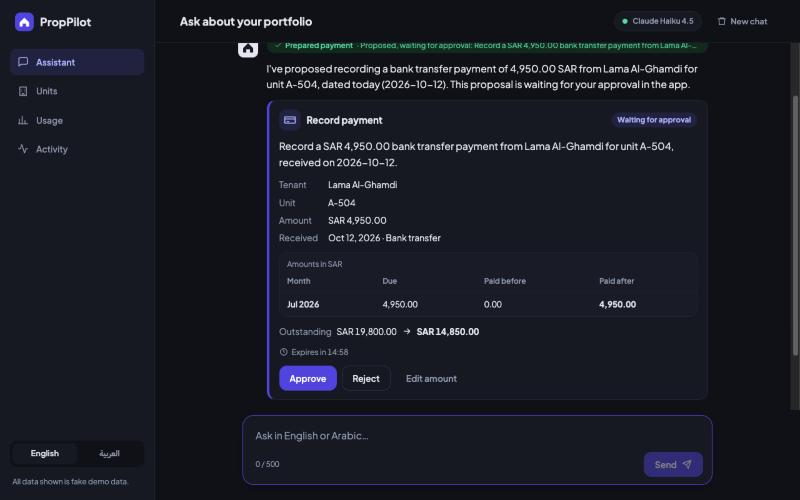
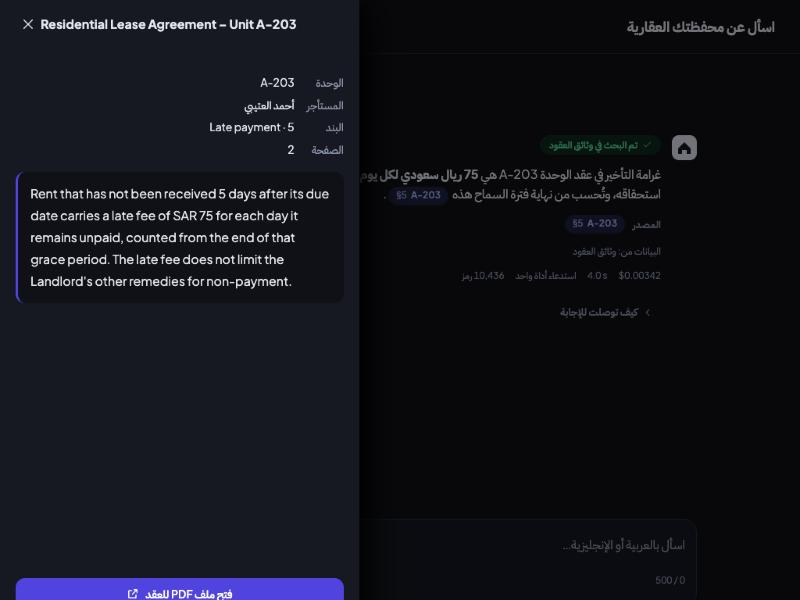
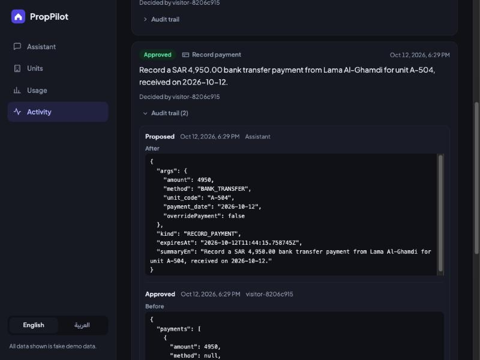

# A 60-second demo

A script to record, or to follow live in an interview. It walks one path through the app: an Arabic question that returns a table, the "How I answered" panel, a follow-up, a lease clause with a citation, a payment that is only proposed, its approval, and the audit trail. The last section maps each step to the part of the [README](../README.md) that explains it.

- **Live demo:** https://proppilot-lake.vercel.app (real Claude, Haiku 4.5, when its badge says so).
- **A recording of this path:** [screenshots/demo.gif](screenshots/demo.gif) (46 s, 1.2 MB, Arabic, the live demo with real Claude, 2026-10-19). It is a scripted capture with a frame at each key moment, not a screen recording, so the waiting between steps is cut.
- **Locally:** `docker compose up --build` gives http://localhost:3000 with the free offline assistant; with `LLM_PROVIDER=anthropic ANTHROPIC_API_KEY=...` it uses Claude (see [Run locally](../README.md#run-locally)). A local stack is the right place to rehearse: approving a payment on the public demo changes data that every visitor shares.

## Before you record

Work through this once, in this order.

- [ ] **Wake the host, five minutes ahead.** The free API sleeps after about 15 idle minutes and takes minutes to boot (about 150 s where I measured it, more when the database is also waking; [DEPLOYMENT.md](DEPLOYMENT.md)). Open the site early and keep it open. The page asks the API for its mode again on its own, so the badge is the sign that the host is awake (see the next item). If there is still no badge after about two minutes, reload the page.
- [ ] **Read the mode badge.** It is in the chat header (in the top bar on a phone-width window). `Claude Haiku 4.5` means real Claude, `Offline demo` means the rule-based assistant. Record with the one you mean to claim. To check from a terminal: `GET /api/info` on the API returns `"mode"`, `"model"`, `"leaseDocuments"`, which must be 30 before a lease question works, and `"retrieval"`, which is `keyword` or `hybrid`. On the runs of 2026-10-12 the demo searched by keywords and trigrams only, so claim vectors only if it says `hybrid`.
- [ ] **Reset the data.** The nightly reset (`demo-reset.yml`, 02:00 UTC) runs only where the repository secrets `DEMO_API_URL` and `ADMIN_TOKEN` are set, so do not assume it ran. Run **Actions, Demo reset, Run workflow**, or call `POST /api/admin/reset` with your `X-Admin-Token`. Then the Activity page must say that there is no activity yet. Without this, another visitor's approval can leave unit A-504 with less than SAR 4,950 outstanding, and the proposal is refused with `amount_exceeds_outstanding`. That is the same condition that fails the eval cases `write-01` and `write-04` on a used deployment ([DEPLOYMENT.md](DEPLOYMENT.md#4-optional-use-real-claude), step 5).
- [ ] **Check the budget.** The demo allows 10 questions a minute per client and 100 a day across all visitors (`render.yaml`). A rehearsal that stops before Approve uses 4 requests (the four questions); the take with the approval uses 5, because the confirmation that follows an approval is a request too. Three rehearsals and the take use 17 of the day's 100, and each rehearsal leaves its proposal on the shared Activity page until the next reset.
- [ ] **Start from an empty chat and set the language to Arabic.** The example chips show only on an empty chat ("محادثة جديدة", New chat, clears it), they follow the page language, and the layout flips right to left.
- [ ] **Put the prompts where you can paste them** (the list below). Typing Arabic live costs more than the whole answer. Enter sends and Shift+Enter starts a new line.
- [ ] **Window at desktop width** (wider than 800 px) so the sidebar with the Activity link shows; narrower, the same links are in a tab bar at the bottom.
- [ ] **Do not rehearse the approval on the public demo.** Approve once, on the take, and reset again afterwards if you want the Activity page clean.

## The script

Timings are targets. With real Claude the 20 read questions of the last measured run averaged 4.45 s per answer (7.09 s at the 95th percentile, [Prompt caching](../README.md#prompt-caching)); the lease and write questions were not timed separately. On a local stack with the offline assistant the committed eval run averaged 9 ms per answer (p95 31 ms).

| Time | What to type or click | What the viewer should see | What to say |
|---|---|---|---|
| 0:00 | Switch to Arabic, then click the example chip **من المستأجرون المتأخرون في الدفع أكثر من 30 يومًا؟** | The page mirrors right to left. A chip "جارٍ فحص الإيجارات المتأخرة…" (Checking overdue rent…) appears, then a table streams in: tenant, unit, days overdue, months, amount. Under it a line naming the data source ("فحص الإيجارات المتأخرة"), and the cost, latency and tokens | "I ask in Arabic. The agent calls a typed tool against the database and streams the table." |
| 0:08 | Click **كيف توصلت للإجابة** under the answer | The panel: model call 1 asked for a tool, the tool call with its arguments (the threshold of 30 days), what it returned, model call 2 wrote the answer; tokens, cost, latency, the model, and a figure check | "Every answer shows its work, drawn from a trace that is stored for each run." |
| 0:16 | Type **ما سجل المدفوعات للوحدة B-203؟** | A chip "جارٍ قراءة سجل الدفعات…" (Reading payment history…), then a month by month table for the tenant at the top of the first table (the tool lists the most overdue first). It shows four unpaid months where the first table showed 3 for this tenant, because that table counts only invoices more than 30 days past due and the newest one, due on the 1st of the month the data was seeded in, is younger (true on 2026-10-12; it stops being true once that invoice is more than 30 days past due) | "A follow-up on the first row. Unit B-203 is Ahmed Al-Harbi. The first table counted three months because it lists only invoices more than 30 days overdue; his history shows all four." |
| 0:26 | Type **ما هي غرامة التأخير في عقد الوحدة A-203؟**, then click the small chip with the unit and `§5` | A chip "جارٍ البحث في وثائق العقود…" (Searching lease documents…), an answer that quotes the late fee clause, and a citation chip inside the sentence. The chip opens a drawer with the lease title, unit, tenant, clause "Late payment · 5", page 2, the clause text and a button that opens the lease PDF | "The answer cites the clause, and the chip opens it. A chip only exists for a clause this search really returned." |
| 0:38 | Type **سجّل دفعة بمبلغ 4,950 ريال للوحدة A-504.** | An approval card with the status "بانتظار الموافقة" (Waiting for approval): tenant Lama Al-Ghamdi, unit A-504, 4,950.00 riyals, the invoice it settles (due 4,950.00, paid before 0.00, paid after 4,950.00), the outstanding balance going from 19,800.00 to 14,850.00 (the first table also showed 14,850 for A-504, but that is three invoices more than 30 days overdue, while the card's figure is what is left of four after one is paid: the same amount, not the same invoices), a countdown that starts at 15:00, and the buttons Approve, Reject and Edit amount. The answer says that nothing has changed yet | "The model can only propose. Nothing is written until a person approves, and the diff is computed by the server." |
| 0:48 | Click **موافقة** (Approve) | The card turns green and says that 4,950.00 was recorded against the oldest unpaid invoices and 14,850.00 is still outstanding. A short confirmation from the assistant follows | "One transaction, a row lock, an idempotency key, and an audit entry. A retry cannot pay twice." |
| 0:54 | Click **النشاط** (Activity) in the sidebar, then **سجل التدقيق** (Audit trail) on the top entry | Two entries: "اقتراح" (Proposed) by the assistant, and "موافقة" (Approved) by `visitor-` and 8 hex characters, with the state before and after | "Who, when, what, and the data before and after. The visitor is anonymous: no address is stored." |

The English version of the same path uses the English chips and prompts below. Three key frames, captured on 2026-10-12 (the approval card and the clause drawer are from the live demo; the audit trail was taken at the minute of the offline runs of the owner's pages, so read it as from a local stack, as the [README](../README.md#screenshots) explains):

## The prompts

| Step | Arabic | English |
|---|---|---|
| 1. Overdue tenants (the example chip) | من المستأجرون المتأخرون في الدفع أكثر من 30 يومًا؟ | Who is more than 30 days late on rent? |
| 2. Follow-up | ما سجل المدفوعات للوحدة B-203؟ | Show the payment history for unit B-203. |
| 3. Lease clause (the example chip) | ما هي غرامة التأخير في عقد الوحدة A-203؟ | What is the late fee in the lease for unit A-203? |
| 4. Propose a payment | سجّل دفعة بمبلغ 4,950 ريال للوحدة A-504. | Record a payment of 4,950 SAR for unit A-504. |

Where they come from: the chips of steps 1 and 3 are the example questions of the app (`frontend/src/i18n/ar.ts` and `en.ts`, `chat.examples`). Step 2 is the eval case `en-09` and `ar-08`; step 4 is `write-01` and `write-04` with the thousands separator added (`4950` works the same, and the offline assistant reads the separator too). The shorter Arabic wording of the first question, **من المستأجرين المتأخرين في الدفع؟** (`ar-03`), has no threshold, so it asks for every tenant with an unpaid month; the tool returns the total and the 15 who are most overdue, and its table counts four months for the chronic tenants (SAR 19,200 for B-203 and SAR 19,800 for A-504), because every unpaid invoice past its due date is in it.

## Why these units and this amount

All of it follows from the seed (`backend/src/main/resources/db/migration/V2__seed.sql`) and the lease generator, and holds on any database migrated by this code. The dates inside the answers are relative to the day of the migration.

| Unit | What it is | Why it is in the script |
|---|---|---|
| **A-504** | Occupied by Lama Al-Ghamdi. Monthly rent SAR 4,950. One of the 11 "chronic" tenants, who have not paid the last four months, so SAR 19,800 is outstanding (the table of step 1 shows 14,850 for it: it counts only the invoices more than 30 days overdue, which leaves the newest out) | A payment of SAR 4,950 settles exactly the oldest unpaid invoice (status `PAID`) and leaves SAR 14,850. It is the unit of the eval write cases |
| **A-203** | Occupied by Ahmed Al-Otaibi. Its lease document `LSE-A-203` exists (the first 30 active leases have one) | Clause 5, "Late payment", says SAR 75 for each day after 5 days (the eval case `rag-01`; [a sample of the PDF](sample-leases/lease-LSE-A-203-english.pdf)). The document is in English, so in the Arabic interface the quoted clause is English: the drawer shows it in the document's own language and direction |
| **B-203** | Ahmed Al-Harbi, the first row of the overdue table (3 months and SAR 14,400 there; its history has four unpaid months and SAR 19,200) | It is the top row of the first table, and its payment history has four unpaid months to show. `en-09` and `ar-08` ask for exactly this |

Two units not to use for it, because they look like the obvious choice:

- **A-504 for the lease question.** It has no lease document. The search tool reports that no lease document is on file for it and tells the model to say so plainly, which is a good thing to show once, and the eval cases `rag-13` and `rag-14` check it, but it is not a citation.
- **A-405 for the payment.** It is vacant, so it has no tenant and no active lease, and the proposal is refused with "Unit A-405 has no active lease".

If you want an Arabic document to open, **B-203** has one (`LSE-B-203`, late fee SAR 240, [a sample](sample-leases/lease-LSE-B-203-arabic.pdf)); the question is `ما غرامة التأخير في عقد الوحدة B-203؟` (`rag-02`).

## If the model answers differently

A model is not a script. These are the differences that can happen, and what each is.

| What you see | What it is and what to do |
|---|---|
| The table looks different, or the wording changed | Normal. The figures come from the tool and the layout is the model's. Open "How I answered" to show that they match the tool result |
| It asks a question that a default should have settled | For example which kind of reminder (`ar-10` did this in the live run of 2026-10-12, and the system prompt now says to default to a rent reminder) or which payment method (the tool defaults to a bank transfer). Answer in a word and carry on |
| No approval card appears | Nothing was proposed, so nothing was recorded; the app cannot change data without a card. Re-ask with the unit and the amount in one sentence |
| "The amount is more than the outstanding balance" or "Nothing is outstanding" | A-504 has been paid down since the last reset. Reset the data (see above) and ask again |
| The follow-up answers about the wrong unit, or says it cannot tell | Name the unit in the question, as the script does. The offline assistant never reads the conversation; a real model can: `turn-01` to `turn-03` passed in every run against real Claude and `turn-04` in one of three, so keep the follow-up of the script short and name the unit if it goes wrong |
| No citation chip, only a marker such as `[LSE-A-203#5]` in plain text | The model cited a clause that this search did not return, or none. By design the app makes a chip only for a returned clause. Ask again |
| "Some figures could not be checked against the data" under an answer | The grounding guardrail flagged a value that no tool result supports. It is a feature, and it is worth showing: click the notice under the answer to list the values. In the last measured runs none of the 20 read answers was flagged, and 1 of 48 lease answers (three runs of 16) was ([Grounding guardrail](../README.md#grounding-guardrail)) |
| "The AI service is busy right now" | The provider was overloaded after the client's retries. Wait a moment and send again |
| "Too many questions" or the daily limit message | The per-minute or the daily cap. Wait a minute, or take the demo to a local stack |
| "This answer was cut off because it reached the length limit" | The reply hit the token limit. Ask a narrower question |
| The approval card says that the proposal expired | A proposal waits 15 minutes. Ask for the payment again |

## What to point at

For an interviewer, in the order the script goes. Each item is something the code does and a test or a measurement backs, not a claim that needs trust.

1. **The badge.** The same app runs with a real model or a free offline assistant, and says which. The loop does not depend on one model ([How the agent loop works](../README.md#how-the-agent-loop-works), [Design decisions](../README.md#design-decisions)).
2. **The chips and the streamed table.** `tool_call`, `tool_result`, `token` and `done` arrive as server-sent events from a hand-written loop with no framework ([SSE events](../README.md#sse-events)).
3. **"How I answered".** The arguments and results of each tool come from the live stream; the tokens, cache tokens, cost, latency, the model and why it was chosen, and the guardrail verdict come from the run's stored trace, which holds no question, answer, arguments or results ([Tracing and observability](../README.md#tracing-and-observability)).
4. **The citation chip.** The marker is parsed in one place, a chip exists only for a clause the search returned, and the retrieval is built as hybrid (vector, full text and trigram, fused with reciprocal rank fusion) and works with no embedding key. The live demo searched by keywords and trigrams only on the runs of 2026-10-12, so say "hybrid" only if `GET /api/info` reports `retrieval` as `hybrid` ([Lease search (RAG)](../README.md#lease-search-rag), [Citation markers](../README.md#citation-markers)).
5. **The approval card.** The model cannot write. The preview, the expiry, the validation and the audit entry are server facts (the idempotency key is made by the browser and the server enforces it), and approval is validated again against the data as it is then ([Human-in-the-loop write actions](../README.md#human-in-the-loop-write-actions), [Approving a change](../README.md#approving-a-change)).
6. **The Activity page.** An audit row for every step, with the state before and after, and a decider who is anonymous by construction ([Safety on the public demo](../README.md#safety-on-the-public-demo)).
7. **The Usage page** (after the demo). Aggregates only, with the model mix and the cache tokens ([Prompt caching](../README.md#prompt-caching)).
8. **What is not claimed.** The README separates what is measured from what is not, and lists what fails and how ([Evals v2](../README.md#evals-v2), [Failure modes I handle](../README.md#failure-modes-i-handle), [What I'd do next](../README.md#what-id-do-next)).

If asked for something to try that is not in the script, these are safe on the shared demo because they change nothing: "What is the weather like in Riyadh today?" should be declined politely (`scope-01`, which passes against the offline assistant in CI and has not been run against real Claude), and "Which leases end in the next 60 days?" is the last example chip. Do not approve more than one payment: the data is shared.

## After the take

Reset the data again (the reset step of the checklist), so that the next visitor does not meet your payment in the Activity page. The reset restores the seeded payments and deletes the proposals, maintenance requests, outbox messages and audit entries; it leaves the stored runs and their traces alone, so your questions stay in the Usage page's totals.
